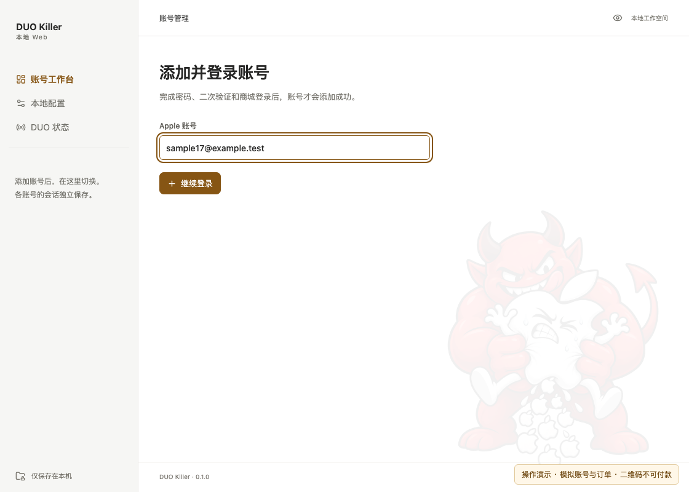
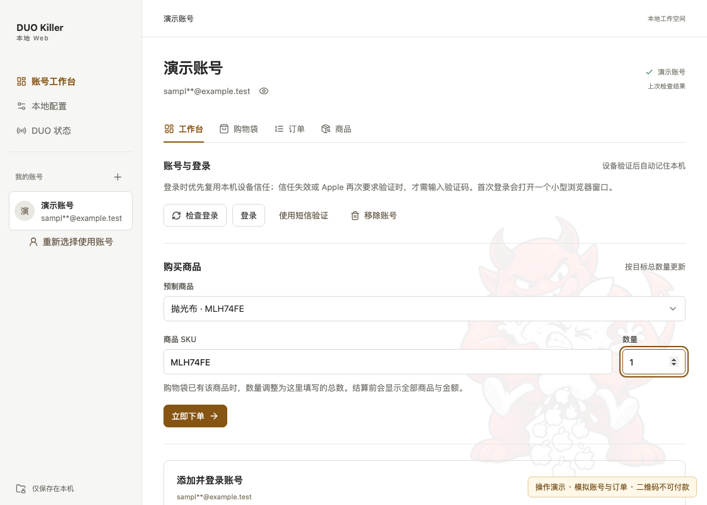
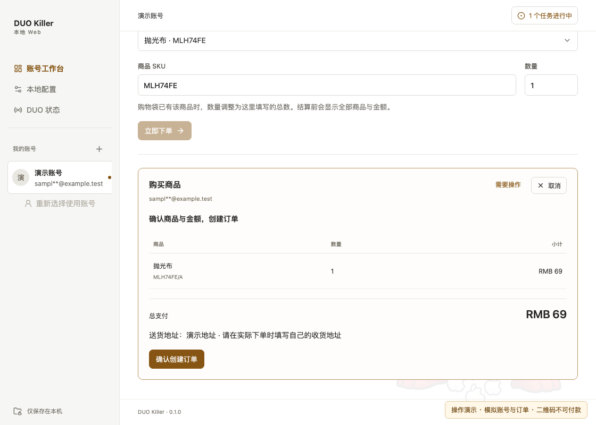
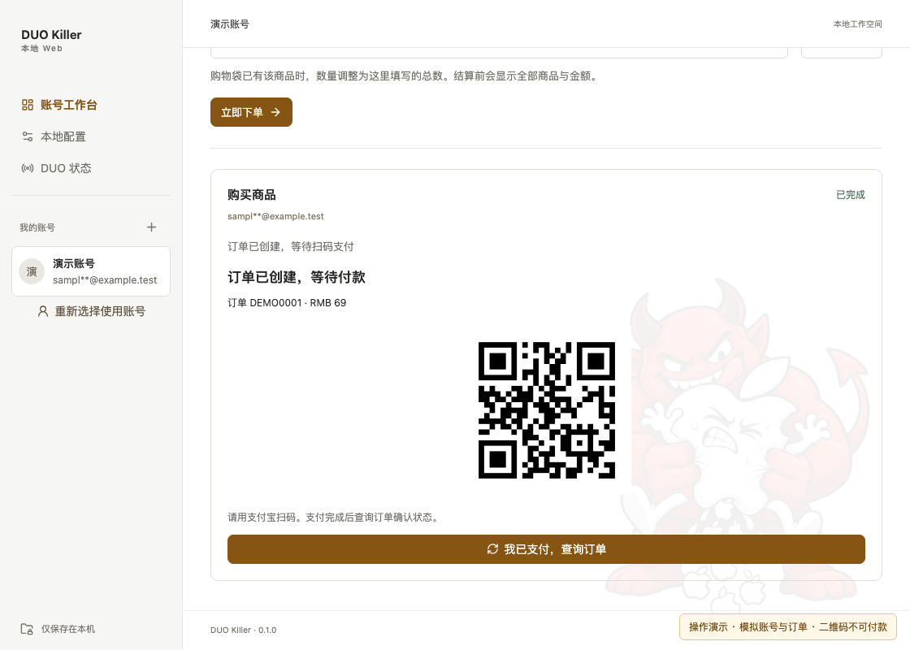
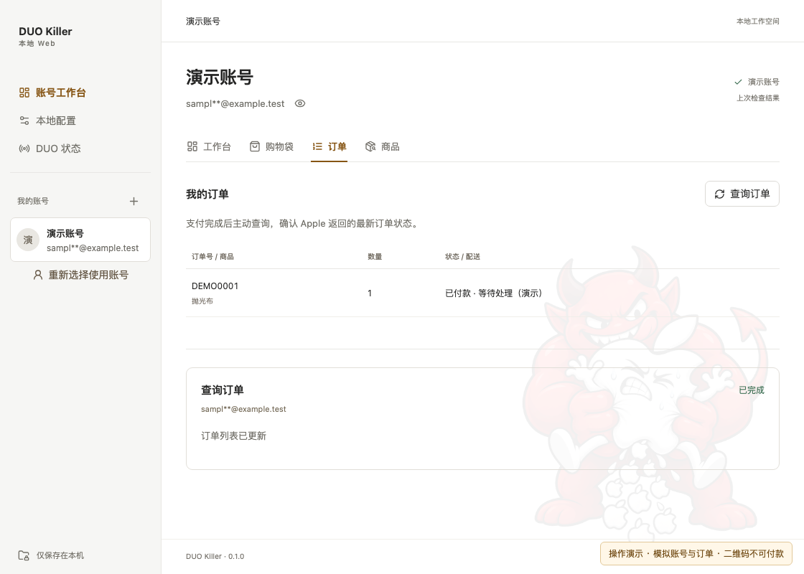

# DUO Killer · iPhone DUO 抢购辅助与 Apple 商城快速下单

面向 **iPhone DUO 抢购准备与快速下单** 的 Apple 中国在线商店辅助工具，支持 **macOS、Windows、Linux 和本地 Web**。提前配置账号、商品 SKU、购买数量和收货地址，在同一个界面完成登录检查、加入购物袋、结账确认、生成付款二维码和订单查询。

iPhone DUO launch assistant and Apple Store quick checkout tool for macOS, Windows, Linux and local Web. Built with Tauri, Rust, React and Python.

## 主要功能

| 功能                | 说明                                                                                             |
| ------------------- | ------------------------------------------------------------------------------------------------ |
| iPhone DUO 发售状态 | 无需登录，手动刷新官网返回的发售提示与商品可购买状态，方便开售前查看。未知状态不代表有货。       |
| 商品与数量预设      | 内置 iPhone DUO 各容量 / 配色及抛光布 SKU，支持自定义 SKU 和购买数量，减少临时填写。             |
| 快速下单            | 点击“立即下单”，依次检查登录、按目标数量更新购物袋并进入结账；核对商品和金额后确认创建订单。     |
| 多账号独立运行      | 每个账号独立保存会话、设备信任和浏览器配置；不同账号可以并行操作，验证码与确认提示标明所属账号。 |
| 登录与设备信任      | 支持设备验证码、短信验证码，保存并复用有效的设备信任；需要重新认证时按提示完成登录。             |
| 配送与门店自提      | 可使用官网已有地址或本地快捷地址，支持选择官网返回的可取货门店。                                 |
| 支付与订单查询      | 「付款码」页按账号展示支付宝付款二维码，扫码付款后查询订单，核对商品、数量及官网返回的订单状态。 |

**DUO 使用流程：**提前配置账号与地址 → 刷新发售状态 → 选择 SKU 和数量 → 立即下单 → 核对并确认订单 → 扫码支付 → 查询订单。

发售状态目前需要手动刷新，库存、价格与是否可购买以 Apple 实际返回为准；付款由本人扫码完成。

## 视频演示

[▶ 在 Bilibili 观看实际操作演示](https://www.bilibili.com/video/BV1v8HQ6FEYz/)

GitHub README 不支持内嵌 B 站播放器，点击上方链接观看完整视频。

## 支持平台

| 版本    | 使用方式                                                     |
| ------- | ------------------------------------------------------------ |
| macOS   | 打开 `.dmg` 安装包，或直接打开构建出的 `.app` 应用           |
| Windows | 运行 `.exe` / `.msi` 安装包，或打开便携目录中的 `.exe`        |
| Linux   | 安装 `.deb`，或直接运行 `.AppImage`（x86_64）                 |
| Web     | 在 macOS / Windows 本机启动服务，用默认浏览器操作            |

Web 版不是在线网站。首次登录获取浏览器上下文时，需要安装 Chrome 或 Edge。已构建版本内置 Python 和依赖；Windows 桌面版还需要 WebView2，Linux 桌面版需要系统提供 WebKitGTK（安装包会自动声明依赖）。Linux 上没有系统凭据保险库，因此**不支持“保存密码”**，每次登录需重新输入密码；设备信任与登录会话照常生效。

## 快速启动（Web）

**使用源码：**准备 Node.js 22.22+、pnpm 11.9、Rust stable、Python 3.10+（建议 3.12）。macOS 需 Xcode Command Line Tools，Windows 需 MSVC C++ Build Tools。具体安装见 [Tauri 前置要求](https://v2.tauri.app/zh-cn/start/prerequisites/)。

克隆仓库后启动：

```sh
git clone https://github.com/ChouHX/Duo.git
cd Duo
pnpm install --frozen-lockfile
pnpm dev:web
```

程序自动准备 Python 环境、编译本地服务并打开浏览器。在启动终端按 **Ctrl+C** 退出服务；仅关闭网页不会退出服务。

**使用构建好的 Web 版：**macOS 双击 `local-web-release/启动.command`，Windows 双击 `local-web-release/start.cmd`。保留整个目录，无需安装开发环境。

## 桌面版（源码开发）

需要 Tauri 前置环境（Rust stable、MSVC C++ Build Tools、WebView2 / Xcode Command Line Tools），然后：

```sh
pnpm install --frozen-lockfile
pnpm worker:setup
pnpm desktop
```

`pnpm worker:setup` 建立 `.venv` 与 Python 依赖；调试模式直接运行 `.venv` 里的 Python 和 `worker/main.py`，**不需要** `pnpm worker:build`（那是打包时才用）。`pnpm desktop` 等价于 `tauri dev`：启动 Vite（1420 端口）、打开 Tauri 窗口并拉起 Python worker，按 Ctrl+C 退出。

## 最简单的购买流程：抛光布

以下为 Web 界面操作截图，使用模拟账号和订单；示例二维码不可付款，金额与状态以实际结账结果为准。

### 1. 正常登录

添加 Apple 账号，输入密码，按提示完成设备或短信验证码。已有账号先勾选，再点击“检查并使用所选账号”。

首次验证后自动保存 Apple 下发的设备信任，下次登录优先复用；只有信任失效或 Apple 再次要求时才输入验证码。设备信任与“保存密码”独立，移除账号会同时清除本机信任；旧 Python 配置导入时也会保留有效信任。



### 2. 选择抛光布

在工作台的“预制商品”选择 **抛光布 · MLH74FE**，数量先设为 **1**，点击“立即下单”。



### 3. 按提示继续结账

选择配送 / 自提、地址等并继续。核对商品、数量、收货信息和总金额，再点击“确认创建订单”，直到显示付款二维码。结账可能包含购物袋里已有的其他商品，请核对完整清单。



### 4. 扫码支付

在实际运行中，用支付宝扫描程序显示的二维码并完成付款。**下图仅为演示，请勿扫码支付。**



### 5. 查询订单

打开“订单”，点击“查询订单”；也可点击付款码下方的“我已支付，查询订单”。确认商品、数量及官网返回的状态，只有待付款订单不代表付款成功。



**移除本地账号：**在账号选择页点击账号旁的“移除”，或进入工作台 → 账号与登录 → “移除账号”，确认后清除该账号在本机的数据和保存密码。未完成登录的账号也可移除；执行中的任务需先完成或取消。官网账号和订单、其他账号、通用预设不受影响。

**账号不再需要勾选：**启动后所有已完成登录的账号**自动启用**并直接列在左侧边栏，点击即可切换（默认停在上次使用的账号）。每个账号行右侧有一个状态点，来自最近一次登录检查：绿色=已确认、红色=需重新登录、蓝色/黄色=正在检查或需要操作、灰色=还没检查过，悬停可看时间。未完成登录的账号也会列在侧边栏（灰显"未完成登录 · 点击继续"），点一下即可续登。

启动时会**自动补检**没有记录、记录超过 6 小时或上次中断的账号（逐个进行，避免被官网限流）；需要输入密码/验证码的账号会停在"需要操作"，不会卡住其他账号。也可以随时在「批量下单 → 各账号进度」点「检查所有账号登录」。

**两级页面：**

- **账号工作台**（侧边栏“账号工作台”）＝ 多账号视角：「工作台」是各账号概览（登录状态、预设商品、进行中的任务，点行可进入该账号），**「批量下单」**一行一件地填好商品（**可多种商品**）后「立即下单（当前账号）」或「并发下单（N 个账号）」，**「购买预设」**与**「商品」**是全局设置（对所有账号生效，与具体账号无关）。
- **账号页**（点击侧边栏里的某个账号）＝ 单账号视角：账号与登录 / 送货方式 / 购物袋 / 订单。“送货方式”是这个账号下单时会用到的本地配置（**快递配送**或**门店自提**，二选一）。
- **通用预设**（侧边栏底部“通用预设”条目）＝ 新账号继承的默认送货方式（自提门店、AppleCare+ 等也在这里）；也可以在任意账号的送货方式里勾“同时写入通用预设”把当前这份复制过去。
- **付款码**（侧边栏“付款码”）＝ 下单结果页：**一个账号一张卡**，卡里是该账号的订单号、金额、AppleCare+ 与支付宝付款二维码，可单独「换一张」「我已支付，查询订单」；下单成功后会自动跳到这里，侧边栏条目上的橙色角标显示待付款账号数。

这样"给一个账号操作"和"给所有账号操作"不会混在一起。

**多商品一起下单：**下单逻辑就是“把商品逐个加入购物袋再结账”，所以一单可以有**多种商品**：每行一个 SKU + 数量（最多 10 种，同一 SKU 重复填写会自动合并数量），提交后按购物袋逐件加购、逐件核对数量，再整体结账。AppleCare+ 会按**每个商品**各自的官网内联推荐分别加入（iPhone 与配件的推荐互不影响），付款二维码与金额以整袋汇总为准。状态行与确认弹窗都会列出全部商品。

**定时抢购（到点自动下单）：**「批量下单」页签下方的「定时抢购」用来卡发售时刻：选好**抢购时间**（精确到秒）与**提前预热**分钟数，点「定时抢购（N 个账号）」，每个已启用账号各排一个定时任务。执行顺序是：

1. **预热**（抢购时间 − 提前量）：立刻刷新该账号的登录会话（Cookie 预检，必要时静默重登；需要密码或验证码时会在这里提示你，所以不会占用整点的几秒钟），并尽量**把商品提前放进购物袋**（还没开售导致加购失败也没关系，会记录下来到点再补）；
2. **到点**：只做两件事——把购物袋补齐到目标数量（刚开售时官网会短时失败，会自动重试）→ 走结账生成付款二维码；
3. 预热万一失败（例如验证码没输完），到点会**重新登录并再试一次**，不会因此放弃。

时间以**侧边栏的网络时间**为准：设置时和临近到点（最后 60 秒）都会自动重新校时，本机时钟快/慢一两秒也不会打偏；计时在 Python worker 里做（到点前 2 秒用高精度轮询），不受窗口最小化或浏览器后台节流影响。计划会记在本机，刷新或重启界面后仍能看到倒计时；期间该账号的其他操作会排队，也可以随时「取消定时抢购」。

**多账号并发下单：**「批量下单」页签里选好商品与数量，点「并发下单（N 个账号）」，确认后一次性为所有已启用账号提交（各账号互不阻塞、并行执行）。每个账号都按自己的本地预设走结账（配送方式、地址、AppleCare+；没填的字段自动用通用预设）。也可在右上角「进行中的任务」里逐个查看、单独取消或重试。注意同时提交多个账号更容易触发官网限流，偶发失败单独重试即可。

> 并发是**按账号**隔离的：同一账号的任务会排队串行（避免同一份会话被并发操作），不同账号之间并行。默认一次最多给单个账号排队 10 个任务。

**网络时间（侧边栏底部）：**显示校时后的北京时间，并标出本机时钟的偏差（例如"本机慢 0.42 秒"），方便对着发售时刻下手；点击可手动重新同步，每 15 分钟自动同步一次。校时使用公开接口 `timeapi.io`（只发送这一次请求，不含任何账号信息；取不到时显示本机时间并提示"同步失败"）。为了允许这次请求，两处 CSP 的 `connect-src` 都仅额外放行了该域名。

**关于浏览器 Profile：**每个账号有独立的持久化 Chrome 配置（`accounts/<账号ID>/.chrome-profile/native`，含 `--restore-last-session`），登录 Cookie 采集与门店查询都复用它，不清空。实测本机耗时：获取浏览器上下文约 2 秒、门店查询（含 Chrome 冷启动）约 1.5 秒、地区级联（纯 HTTP）约 0.4 秒——Profile 已经是复用的，速度瓶颈不在这里，而在官网往返本身。若登录态失效（`as_ltn_cn` / `shld_bt_ck` 缺失或过期）才会重新走一遍登录。

## 购买预设与快捷地址

页签分工：账号页是**账号与登录 / 送货方式 / 购物袋 / 订单**（单账号）；「账号工作台」是**工作台 / 批量下单 / 购买预设 / 商品**（多账号或全局）；「通用预设」只有**送货方式**（新账号的默认地址与送货方式）。

**送货方式（每个账号只选一个）：**“送货方式”卡片里选**快递配送**或**门店自提**，只显示对应的配置——选快递配送就填快捷地址，选门店自提就查并保存取货地区。切换时会立刻写进该账号的 `checkout.json`（`delivery_method`），下单时**直接按它走**，不再询问收货方式。AppleCare+ 开关也在同一张卡片里（对两种方式都生效）；卡片里还有一句说明：下单全程全自动。

**保存购买预设：**在「账号工作台 → 购买预设」里选预制商品，或选“自定义 SKU”后填写 SKU 和数量；点「添加商品」可以存**多种商品**（最多 10 种），每行一个 SKU + 数量，点行尾的删除按钮移除。保存后这份多商品预设就是批量下单表单的默认值。购买预设是**全局**的：新账号自动继承，仍在用旧默认值的账号会在保存时一起跟随更新（已经在用别的 SKU 的账号不会被覆盖）；批量下单表单也以它作为默认值。

**扩充内置商品列表：**在 [`src/products.ts`](src/products.ts) 的 `presetProducts` 中，照抛光布条目的格式添加 `sku`、`name`、`price`，然后重新构建。列表已内置实测的 iPhone 18 Pro 256GB 冰川蓝色（`MJTA4CH`，参考价 9,999）与 iPhone Duo 系列、抛光布。`price` 仅作参考，支付金额以官网结账结果为准；本地保存自定义 SKU 不会自动新增下拉列表条目。

**配置快捷物流地址：**在账号页（或“通用预设”）的“送货方式”页签填写姓名、通知邮箱、手机号、省市区和详细地址，点击“保存地址预设”。结账时选择“为我送货”，再选择使用本地快捷地址；仍可选择官网已有地址。

**购物袋金额读不出来时不会中断：**刷新购物袋只是只读查询，官网对某些商品不返回价格时，列表照常显示并在底部提示"官网未返回可识别的购物袋合计金额……"；只有**下单前**核对订单总额时才严格要求金额，读不到会停止提交（错误信息里会带上官网的原始返回值）。

**读取官网地区与省市区联动：**省 / 市 / 区是官网真实数据的级联下拉（`shop/address-lookup`）：选省自动加载市、选市自动加载区，不需要登录会话，通用预设同样可用。选择具体账号后，还可以点“读取官网地区”填入该账号官网的默认收货地址（姓名、手机号、省市区、详细地址）。仍需点击“保存地址预设”才会保存在本机；若官网 store 会话过期，读取地区时会自动重新登录。

**AppleCare+（可选，含"随心换"，默认不勾选）：**勾选"同时加入 AppleCare+ 服务计划（含 iPhone 年年焕新）"后，结账前会读取购物袋里官网给出的 **AppleCare+ 内联推荐**（`shoppingCart.items.<商品>.inlineRecommendations.<AC SKU>`，动作名 `add`），把它一并加入再下单；默认不勾选，保持裸机下单。加入结果（名称与价格）会显示在任务面板的付款二维码上方。商品已挂 AppleCare+ 时官网不再下发该推荐，所以天然幂等、不会重复加；加入失败会停止下单并报错，不会悄悄按裸机提交。价格以官网为准（如 iPhone 18 Pro 256GB 为 RMB 1,799）。

**下单始终全自动：**界面里**没有**“全自动下单”开关——下单方式就是全自动：不询问配送方式、不询问地址来源、不做二次确认，直接用本地预设（送货方式 + 快捷地址 / 自提门店 + AppleCare+）创建订单并生成付款二维码（实际支付仍需扫码完成）。保存地址或送货方式时会把配置里的 `auto_checkout` 归一为 `true`，所以历史配置也不会退回到需要手选的老行为。

**地址信息一次填完：**“快捷送货地址”按行分组——姓氏 + 名字一行、通知邮箱 + 手机号一行、省 / 直辖市 + 城市 + 区 / 县一行、详细地址独占一行（窄屏自动改成单列）。

下单时读取配置的顺序：先看该账号自己的 `checkout.json`，没填的字段自动回退到通用预设（`settings/checkout.json`）——所以只填通用预设也能直接下单；两个地方都没填才会在结账时询问。

**自提门店（只选地区，自动就近）：**选中“门店自提”后，只需按“省 → 市 → 区”选定取货地区（数据来自官网 `shop/address-lookup`，不需要登录），点“保存取货地区”即可——**不需要指定门店**。下单时会**先把自提页的地区切到你选的地区**（官网只按当前地区返回并按距离排序门店，这一步没做就跑偏了），再在官网返回的门店里**自动选择最近且有货的那一家**，因此不会因为指定门店缺货而失败。某地区全部门店不可用时会自动改用送货，并在下单结果和「付款码」页写明「没有 XX 可用的自提门店，已改为快递配送。」——不会静默换方式。想先看看有哪些店，可点“查询附近门店”，列表来自官网 `shop/fulfillment-messages`（按「购买预设」里的 SKU 返回各家取货可用性，如“今天可取货”“暂无供应”）。官网只提供另一种送货方式时（例如商品仅支持配送），也会自动改用可用的那一种并打印说明，不会卡住下单。

> 官网对脚本请求（`requests`）会返回 541，所以门店查询借本机 Chrome 的专用配置发起（先取 `as_atb` 反爬令牌，再在页面内 fetch），首次查询需要几秒钟；不需要 Apple 登录会话，所以通用预设也能查询并预设门店。

工作台顶部（账号信息之下）是功能页签：账号工作台为 **工作台 / 批量下单 / 购买预设 / 商品**，账号页为 **账号与登录 / 送货方式 / 购物袋 / 订单**；右侧“进行中的任务”可随时跳回某个账号的任务。

**底部固定提示条（只放日志与提示）：**右侧容器底部固定一条任务/日志栏（`position: sticky`，不随内容滚动）：一行说明"在做什么任务、哪个账号、执行到哪一步、结果或错误是什么"，比如「购买商品 · 已中断 · 15212\*\*@qq.com · 应用上次退出时任务中断，可重新发起操作」。它**只显示日志和提示**：需要输入（密码/验证码、二次确认）时在这一条下面展开；下单结果（付款二维码、金额明细）不在提示条里显示，而是集中到「付款码」页，一个账号一张卡。

**说明文字收进图标：**DUO 状态、快捷送货地址、自提门店等区块的长说明默认收起，鼠标悬停标题右侧的 ⓘ 图标（或键盘聚焦）才展开，界面默认保持干净。

**打开官网：**DUO 状态页的“打开官网”按钮与“刷新状态”在同一行，点击后用**系统默认浏览器**打开官网选购页（桌面版走 `open_url` 命令，本地 Web 版直接开新标签）。

“通用预设”同时是所有账号的**兜底值**：账号自己没填的字段（地址、联系人、送货方式与取货门店）都会自动使用通用预设，新添加的账号也会复制一份；选择具体账号则只修改该账号。地址预设保存在本机，不会直接修改官网地址簿。

## 构建

在目标系统及对应架构上构建，不能把 macOS / Windows / Linux 的产物拿到别的系统使用。先准备上述开发环境。

### macOS

```sh
pnpm install --frozen-lockfile
pnpm worker:setup
pnpm worker:build
pnpm bundle
```

输出（都在 `src-tauri/target/release/bundle/` 下）：

| 产物               | 路径                                        | 说明                                                        |
| ------------------ | ------------------------------------------- | ----------------------------------------------------------- |
| **安装包（推荐）** | `dmg/DUO Killer_0.1.0_aarch64.dmg`          | 拖入“应用程序”安装；Apple Silicon 为 `aarch64`，Intel 为 `x64` |
| 应用本体           | `macos/DUO Killer.app`                      | 可直接双击运行；分享时需保留整个 `.app`                     |

当前构建未配置发行签名和公证。若首次打开提示无法验证开发者，确认来源可信后，先尝试打开一次，再到 **系统设置 → 隐私与安全性 → 仍要打开**，确认“打开”。此方法针对未认证开发者提示；不要忽略恶意软件或损坏警告。参见 [Apple 官方说明](https://support.apple.com/zh-cn/102445)。

### Windows

安装 Visual Studio C++ Build Tools，勾选“使用 C++ 的桌面开发”，并安装 WebView2；详见 [Tauri 前置要求](https://v2.tauri.app/zh-cn/start/prerequisites/)。打包所需的 NSIS / WiX 工具链由 Tauri 首次构建时自动下载并缓存（`%LOCALAPPDATA%\tauri`），之后可以离线构建。在 PowerShell 中进入项目目录，执行：

```powershell
pnpm install --frozen-lockfile
pnpm worker:setup          # 建 .venv 与运行依赖
.venv\Scripts\python.exe -m pip install -r worker/build-requirements.txt   # 打包用的 PyInstaller
pnpm worker:build          # PyInstaller 打包 worker 到 src-tauri/resources/worker
pnpm bundle                # 构建并生成安装包（nsis + msi）与免安装目录
```

输出（三选一，都在 `src-tauri/target/release/bundle/` 下）：

| 产物               | 路径                                  | 说明                                                                                                                                   |
| ------------------ | ------------------------------------- | -------------------------------------------------------------------------------------------------------------------------------------- |
| **安装包（推荐）** | `nsis/DUO Killer_0.1.0_x64-setup.exe` | 单文件安装程序，约 **38 MB**，双击按向导安装（默认当前用户，无需管理员），自带开始菜单快捷方式与卸载项；安装语言可选简体中文 / English |
| MSI                | `msi/DUO Killer_0.1.0_x64_en-US.msi`  | 约 **41 MB**，适合 `msiexec /i` 静默部署                                                                                               |
| 免安装目录         | `portable/DUO Killer/`                | 直接把 `DUO Killer.exe` + `worker/` 放在一起，双击即可运行；分享时**必须保留整个目录**（删掉 `worker/` 就无法登录与下单）              |

静默安装 / 卸载示例：

```powershell
# 静默安装到指定目录（/D 必须放在最后，且不要加引号）
& ".\DUO Killer_0.1.0_x64-setup.exe" /S /D=C:\Tools\DUOKiller
# 卸载
& "C:\Tools\DUOKiller\uninstall.exe" /S
```

安装包里已经内置了打包好的 Python worker，所以**目标电脑不需要安装 Python**，只需要能联网、并且装有 Chrome 或 Edge 之一。worker 的处理方式：

- `pnpm worker:build` 用 PyInstaller 把 `worker/main.py` 连同 CPython 解释器、标准库与依赖（requests / srp / playwright / qrcode / keyring / tzdata）打成**冻结的可执行文件** `worker/duo-killer-worker.exe`（onedir 形式，旁边一个 `_internal/` 放运行时与 Playwright 驱动 `node.exe`）；
- 打包时把它放进 `src-tauri/resources/worker/`，Tauri 会把整个目录随安装包分发，安装后位于 `<安装目录>/worker/`；
- 运行时 Rust 端（桌面版 `src-tauri/src/main.rs`、本地 Web 版 `local-web/src/main.rs`）按 `resource_dir()/worker/duo-killer-worker.exe` 找到它，**每个任务启动一个独立进程**（参数 `--data-dir / --account-id / --task-id`，stdin 收一行 JSON 请求，stdout 回 JSON 事件流），同一账号的任务靠文件锁 + 引擎信号量串行，不同账号并行；
- 只有**开发模式**才用 `.venv` 里的系统 Python 跑 `worker/main.py`，所以开发机需要 `pnpm worker:setup`，而装到别人电脑上的正式版不需要任何 Python 环境；
- 浏览器本身没有打包：worker 通过 Playwright 驱动调用**系统已安装的 Chrome 或 Edge**（登录窗口、门店查询、需要过反爬的接口都走它）。

> **为什么没有“真正的单文件 exe”？** 桌面版由三部分组成：Tauri 外壳（约 10 MB）+ 系统 WebView2 运行时（Windows 自带）+ Python worker（约 53 MB，解包后包含 Playwright 与依赖）。worker 需要落地成一个目录才能被拉起，所以“一个 exe 双击即用”的形式只能靠安装包（单文件 `setup.exe`）或免安装目录来实现；`pnpm bundle` 默认两种都产出。
>
> 想进一步减少文件数可以把 worker 打成 PyInstaller `--onefile`，但那样每次任务启动都要把 ~50 MB 解压到临时目录（每个任务慢 1–3 秒），且杀软误报概率更高，因此保持 `--onedir`。
>
> 当前构建**未配置代码签名**：首次运行 `setup.exe` 或应用时可能出现 SmartScreen“Windows 已保护你的电脑”提示，确认来源可信后点“更多信息 → 仍要运行”。

### Linux

在 Ubuntu 22.04 / Debian 等发行版上安装构建依赖（其它发行版用对应的包名）：

```sh
sudo apt-get install -y libwebkit2gtk-4.1-dev libappindicator3-dev librsvg2-dev \
  libxdo-dev libssl-dev patchelf file libfuse2
```

然后：

```sh
pnpm install --frozen-lockfile
pnpm worker:setup          # 建 .venv 与运行依赖
pnpm worker:build          # PyInstaller 打包 worker 到 src-tauri/resources/worker
pnpm bundle                # 构建并生成 deb + AppImage
```

输出（都在 `src-tauri/target/release/bundle/` 下）：

| 产物               | 路径                                       | 说明                                                          |
| ------------------ | ------------------------------------------ | ------------------------------------------------------------- |
| **安装包（推荐）** | `deb/DUO Killer_0.1.0_amd64.deb`           | 双击或 `sudo apt install ./…deb` 安装（命名以实际构建为准）    |
| 免安装             | `appimage/DUO Killer_0.1.0_amd64.AppImage` | `chmod +x` 后直接运行，无需安装（依赖系统 WebKitGTK）          |

> 打包产物与目标架构绑定：在 x86_64 机器上产出 `amd64`，不要在 macOS / Windows 上交叉构建。Linux 上同样不保存密码（无系统凭据保险库），登录时按提示输入密码即可。

### 构建 Web 版

在 macOS 或 Windows 的项目目录执行：

```sh
pnpm install --frozen-lockfile
pnpm build:web
```

输出：`local-web-release/`，复制整个目录给相同系统和架构的电脑使用。项目提供 [桌面构建 CI](.github/workflows/build.yml)（覆盖 **macOS ARM / macOS Intel / Windows x64 / Linux x64**）；推送 `v*` 标签或手动触发即可在 Actions 的 Artifacts 里下载各平台安装包。

## 隐私与免责声明

账号、Cookie、地址和支付信息保存在本机。**不要上传或分享 `auth.json`、账号 / 地址 / 支付 JSON、浏览器配置、抓包文件和本地服务启动链接。**具体检查结果见 [隐私检查记录](docs/PRIVACY.md)。

**禁止商业用途，仅供学习和交流。**本项目不是 Apple 官方产品，与 Apple 无隶属或授权关系。请仅使用自己的账号，遵守适用法律和平台规则。下单、付款会产生真实交易，请自行核对并确认；本项目不保证商品库存、价格或接口持续可用。
